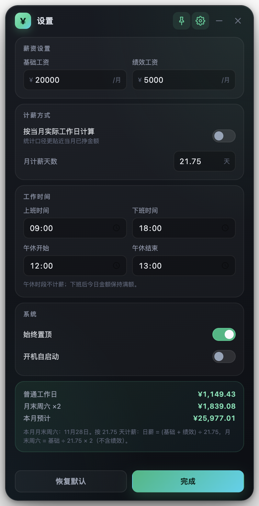

# 工资实时统计（SalaryTime）

一个常驻桌面的工资悬浮窗：**实时显示今天、此刻已经挣了多少钱**，同时统计本月、本周累计收入。支持 21.75 天标准计薪与「当月实际工作日」两种口径，月末周六按双倍基础工资计算。

基于 Electron 构建，可打包为 Windows 安装包 / 免安装 exe，也提供 macOS 应用。




> 安装包下载、更新说明与文件校验见 [v1.0.0 发布说明](docs/release-notes-v1.0.0.md)。

## 功能

- **今日已赚**：按今天的工作进度实时跳动，精确到分；午休期间冻结，下班后保持满额。
- **本月累计 / 本周累计**：从月初 / 本周一累计到当前时刻，并显示本月、本周的预计收入与进度条。
- **两种计薪口径**
  - 默认：固定按 **21.75 天** 摊算日薪。
  - 勾选「按当月实际工作日计算」：按当月周一至周五的实际天数摊算，更适合查看当月已累计挣到多少。
- **月末周六双倍**：当月最后一个周六按 `基础工资 ÷ 计薪天数 × 2` 计算，**不含绩效**；普通工作日则包含基础 + 绩效。
- **可自定义**基础工资、绩效工资、计薪天数、上下班时间、午休时间。
- **悬浮窗体验**：无边框圆角、可拖动、置顶开关、隐藏到系统托盘、一键退出、开机自启动、设置自动保存。
- **实际工作日可手动覆盖**：遇到法定节假日 / 调休时，可手动填写当月计薪天数。

## 默认参数

| 参数 | 默认值 |
| --- | --- |
| 基础工资 | ¥20,000 / 月 |
| 绩效工资 | ¥5,000 / 月 |
| 月计薪天数 | 21.75 天 |
| 上班时间 | 09:00 |
| 下班时间 | 18:00 |
| 午休 | 12:00 – 13:00（不计薪） |
| 每日有效工时 | 8 小时 |

## 计算规则

### 21.75 天模式（默认）

```
普通工作日日薪 = (基础工资 + 绩效工资) ÷ 21.75
月末周六日薪 = 基础工资 ÷ 21.75 × 2        （不含绩效）
其他周末      = 0
今日已赚      = 当日日薪 × 当日工时进度     （午休时段冻结）
```

默认参数下：普通工作日 **¥1,149.43 / 天**，月末周六 **¥1,839.08 / 天**。

### 当月实际工作日模式（勾选后）

```
计薪天数 = 当月周一至周五的天数（可手动覆盖）
普通工作日日薪 = (基础工资 + 绩效工资) ÷ 计薪天数
月末周六日薪 = 基础工资 ÷ 计薪天数 × 2      （不含绩效）
```

例如 21 个工作日的月份：普通日薪 ¥1,190.48，月末周六 ¥1,904.76。

### 累计口径

- **本月累计**：本月 1 号到当前时刻的应得工资（今天按工时进度折算）。
- **本周累计**：本周一（含跨月）到当前时刻的应得工资。
- **本月预计 / 本周预计**：整月 / 整周全部计薪日的应得工资之和。

> 「月末周六」指**当月最后一个周六**。它不计入周一至周五的工作日数，属于额外的双倍加班日，因此本月预计有可能略高于月薪。

## 使用方式

| 操作 | 说明 |
| --- | --- |
| 拖动标题栏 | 移动悬浮窗，位置会记住 |
| 图钉按钮 | 切换窗口置顶 |
| 齿轮按钮 | 打开 / 关闭设置 |
| 减号按钮 | 隐藏到系统托盘 |
| × 按钮 | 退出应用（退出前自动保存设置） |
| 托盘图标 | 单击显示 / 隐藏；右键菜单可退出 |
| `Esc` | 从设置返回主界面 |
| `Cmd/Ctrl + Q` | 退出应用（macOS 默认快捷键） |
| 设置项 | 修改后自动保存，无需手动确认 |

设置数据保存在：

- Windows：`%APPDATA%\SalaryTime\settings.json`
- macOS：`~/Library/Application Support/SalaryTime/settings.json`


## 在 macOS 上使用

推荐使用一键启动器方式，不需要 Apple 开发者账号，也不用处理未签名应用的 Gatekeeper 拦截：

```bash
npm install
npm run install:mac
```

完成后从「启动台」或 Spotlight 搜索 **工资实时统计** 打开；关闭时点悬浮窗右上角的 **×**。

> 启动器引用当前项目目录，如果移动或删除了项目，请在新位置重新执行 `npm run install:mac`。
> 需要开机自启时，请到「系统设置 → 通用 → 登录项」中添加「工资实时统计.app」。
> 详细步骤与常见问题见 [macOS 安装教程](docs/macos-install.md)。
> `npm run dist:mac` 仍可生成传统 DMG，但未签名 DMG 在部分 macOS 上无法直接双击启动。

## 在 Windows 上使用

仓库的 `dist/` 目录（如果已执行过打包）会生成两个文件：

| 文件 | 说明 |
| --- | --- |
| `SalaryTime-Setup-1.0.0.exe` | 安装版。可选安装目录，自动创建桌面 / 开始菜单快捷方式「工资实时统计」 |
| `SalaryTime-Portable-1.0.0.exe` | 免安装便携版，双击即用，可放到任意目录或 U 盘 |

> 程序未做商业代码签名，首次运行 Windows SmartScreen 可能提示「Windows 已保护你的电脑」，点击「更多信息 → 仍要运行」即可。

系统要求：Windows 10 / 11（x64）。

## 从源码运行

```bash
npm install
npm start
```

如果 Electron 二进制下载失败（国内网络），可先设置镜像：

```bash
export ELECTRON_MIRROR="https://npmmirror.com/mirrors/electron/"
npm install
```

## 打包 macOS 应用

```bash
npm run dist:mac
```

产物：`dist/SalaryTime-1.0.0-arm64.dmg`（未签名，本机使用没有问题）。

## 打包 Windows exe

### Windows 上打包

```bash
npm install
npm run dist:win
```

如果打包工具（NSIS / 7-Zip）下载失败，可先设置镜像：

```bash
# PowerShell
$env:ELECTRON_BUILDER_BINARIES_MIRROR="https://npmmirror.com/mirrors/electron-builder-binaries/"
# cmd
set ELECTRON_BUILDER_BINARIES_MIRROR=https://npmmirror.com/mirrors/electron-builder-binaries/

npm run dist:win
```

产物在 `dist/`：

- `SalaryTime-Setup-1.0.0.exe`
- `SalaryTime-Portable-1.0.0.exe`

### macOS / Linux 交叉打包（无需 Wine）

electron-builder 26 使用纯 JS 的 `resedit` 写入图标和版本信息，因此在 macOS 上也可以直接生成 Windows 安装包：

```bash
npm install
export ELECTRON_BUILDER_BINARIES_MIRROR="https://npmmirror.com/mirrors/electron-builder-binaries/"
npx electron-builder --win --x64
```

只打便携版：

```bash
npx electron-builder --win portable --x64
```

## 测试

```bash
npm test        # 计薪逻辑单元测试（17 项）
npm run test:ui # 渲染层冒烟测试（32 项断言，需要桌面环境）
```

单元测试覆盖：21.75 / 实际工作日两种模式、月末周六双倍、午休冻结、跨月周累计、自定义工时、倒计时等。

## 项目结构

```
salary-time/
├── src/
│   ├── main.js              # 主进程：窗口、托盘、设置持久化、开机自启
│   ├── preload.js           # 安全的 IPC 桥接
│   ├── shared/
│   │   ├── defaults.js      # 默认设置
│   │   └── calc.js          # 计薪核心逻辑（纯函数）
│   └── renderer/
│       ├── index.html       # 悬浮窗 + 设置面板
│       ├── styles.css       # 界面样式
│       └── app.js           # 渲染与交互
├── test/
│   ├── calc.test.js         # 单元测试
│   └── ui-smoke.js          # Electron UI 冒烟测试
├── scripts/
│   ├── electron-run.js      # 跨平台启动包装
│   ├── install-macos-launcher.js  # 生成 macOS 双击启动器
│   └── generate_icons.py    # 生成 png / ico / 托盘图标
├── build/                   # 图标资源
├── docs/                    # 截图
└── package.json             # 依赖、脚本与 electron-builder 配置
```

## 已知限制

- 后端未内置中国法定节假日日历。实际工作日模式默认只统计周一至周五；遇到节假日 / 调休时，请在设置里手动填写「当月工作日」。
- 只有最后一个周六按双倍工资计算；其他周末不计薪。
- 21.75 天模式下，本月预计 = 当月工作日数 × 日薪 + 月末周六双倍，可能高于月薪，这是按 21.75 摊算 + 额外加班日的自然结果。
- 开机自启动仅在打包安装后生效。
- 目前仅提供 x64 Windows 构建。

## License

[MIT](LICENSE)
